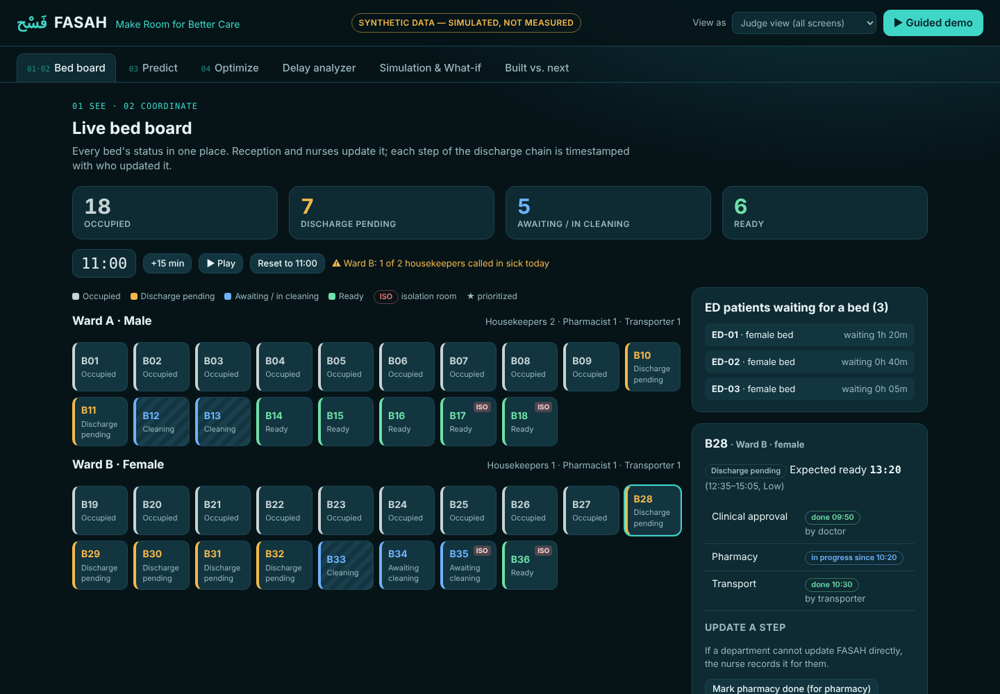
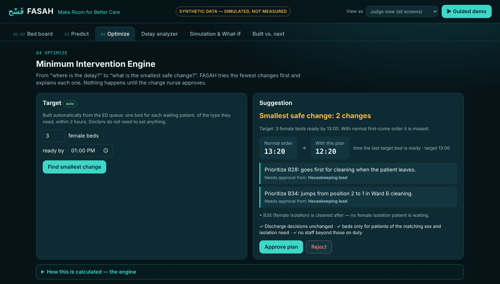
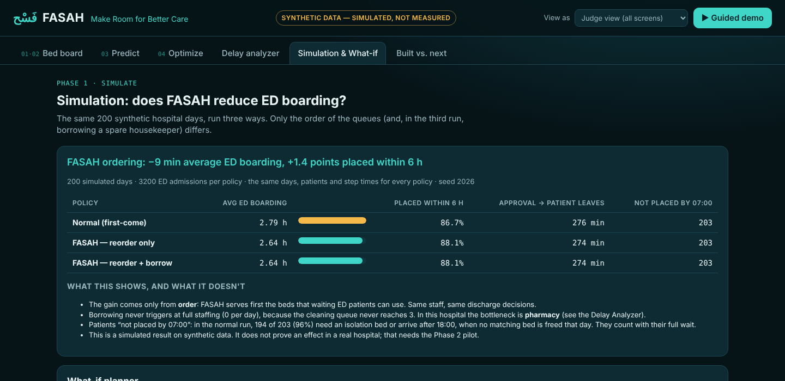

# FASAH | فَسْح — Make Room for Better Care

**Intelligent hospital bed and patient flow management.** Team FASAH · Medathon 2026 · Track: Healthcare Crowd & Patient Flow Management

**▶ Live demo:** _link added after publishing to GitHub Pages_ · Press **“Guided demo”** for the 3-minute story.

> **Everything in this demo uses synthetic data. Results are simulated, not measured.** Published figures we cite are labelled as other teams' results, not FASAH outcomes.

This repository is **Phase 1 (Simulate)** of FASAH's four-phase roadmap, built and working. The sections below follow the Medathon Filter 2 template, in order.



---

## 1. Problem & Solution

**Problem.** Patients wait in the emergency department (ED) for an inpatient bed while suitable beds stay tied up in unfinished, poorly coordinated tasks: discharge approved but medication not ready, transport not booked, room not cleaned. Each department sees only its own part of the chain.

**Solution.** FASAH runs one operational loop:

| Step | What it does |
|---|---|
| **01 See** | A live board with every bed's status (occupied · discharge pending · cleaning · ready) |
| **02 Coordinate** | The discharge chain with one owner per step; every update timestamped with who made it |
| **03 Predict** | When each bed will be ready, with a range and a confidence level |
| **04 Optimize** | The **Minimum Intervention Engine**: finds the smallest safe change that meets the ED's need, for a charge nurse to approve |

## 2. Evidence of Need

Published evidence (these are **not** FASAH results):

- **Ensiab Project**, six Saudi Ministry of Defence tertiary hospitals: mean ED boarding fell from **16.6 h to 9.5 h** after coordinated flow interventions (multidisciplinary flow teams, the NHS SAFER bundle, visual management, bed huddles). The project's target was boarding under **6 hours**. Its "time till discharge" fell from **265 to 117 min**, and discharges before noon rose from **16% to 36%**. ([Alotaibi et al., BMJ Open Quality 2021](https://doi.org/10.1136/bmjoq-2021-001505))
- **Al Hada Armed Forces Hospital, Taif:** a case-management programme reduced ED boarding from 11.9 to 1.2 hours. ([BMJ Open Quality 2024](https://pmc.ncbi.nlm.nih.gov/articles/PMC10910643))

Both show that coordination, not just more beds, shortens boarding. They also relied on people and meetings. FASAH aims to make that coordination continuous and visible, without waiting for the next huddle.

## 3. How It Works

```
Clinical approval (doctor) ──► Pharmacy ─┐
                               Transport ─┴─► Patient leaves ──► Cleaning ──► Ready ──► ED patient assigned
                               (in parallel, each only if needed)
```

- **Roles:** reception and nurses update statuses (a nurse can record a step for pharmacy, transport or housekeeping, and it is labelled as such). The charge nurse approves engine suggestions. The executive doctor or manager sees reports. **Doctors never have to set targets.**
- **Predict:** each queue is replayed forward three times, with every step fast, typical and slow. The bed's position in each queue and the staff on duty decide its wait.
- **Optimize:** FASAH builds the target automatically from the ED queue (e.g. *3 female beds by 13:00*). It then tries changes in this order:
  1. none needed (on track);
  2. prioritize 1, then 2, then 3 beds;
  3. borrow 1 spare housekeeper from another ward;
  4. otherwise "not possible", plus the smallest extra staff member that would make it possible.
- **Hard safety rules:** FASAH never approves or delays a discharge. It assigns a bed only to a patient of the matching sex and isolation need, and it never uses staff who are not on duty or spare. Every change names who must approve it.



## 4. Innovation & Alternatives

Hospitals already use bed-management modules in their hospital record systems, central command centres and daily bed huddles. These mainly **show** status, and some forecast it. FASAH's difference is the **Minimum Intervention Engine**. Instead of only showing where the delay is, it answers *"what is the smallest safe change that meets this target?"*. It explains each change and names who must approve it, or says plainly that the target is not possible and what it would take. It also adds the **Delay Analyzer** and a **What-if planner**, which let a manager test a hiring decision on simulated days before paying for it.

## 5. Prototype / Proof of Concept

This website is the working prototype. Nothing is mocked. Every number on screen is calculated by the code in `src/core/`.

| Screen | Who | What you can do |
|---|---|---|
| Bed board | Reception, nurse, charge nurse | Record discharge approvals, mark steps done, assign beds, run the clock (+15 min / play) |
| Predict | Nurse, charge nurse | See expected ready times, ranges, confidence and queue positions |
| Optimize | Charge nurse | Edit the auto target, find the smallest change, approve or reject |
| Delay analyzer | Manager | See where waiting happens, by step, ward and time of day |
| Simulation & What-if | Manager | Compare 200 simulated days; change staffing and re-run |
| Built vs. next | Everyone | What is done and what each later phase adds |

Each calculation screen has a **"How this is calculated"** panel showing the formula and the actual numbers used.

**The live story (guided demo).** At 11:00, Ward B is one housekeeper short and three women wait in the ED. With first-come order, the third female bed is ready at **13:20**, which misses the 13:00 target. The engine's smallest change is to **prioritize B34 and B28**: no extra staff, and the isolation room is cleaned afterwards because no isolation patient is waiting. That makes the third bed ready at **12:20**.

## 6. Data & Tools Used

**Data:** fully synthetic, generated with a seeded random number generator (seed 2026), so anyone can re-run it and get identical results. All parameters are in [`src/core/hospital.js`](src/core/hospital.js):

| Parameter | Value |
|---|---|
| Beds | 36 in 2 wards (A male, B female), 2 isolation rooms each |
| Staff per ward | 2 housekeepers, 1 discharge pharmacist, 1 transporter |
| Step times, minutes (fast / typical / slow) | Pharmacy 45 / 90 / 240 · Transport 20 / 45 / 120 · Cleaning 20 / 30 / 45 · Isolation cleaning 45 / 60 / 90 |
| Needs | 70% need discharge medication, 40% need hospital transport |
| Simulated day | 10 discharge approvals per ward (08:00–14:00); 16 ED admissions (07:00–21:00), 10% needing isolation |

**Calibration:** pharmacy and transport times are set so the simulated normal hospital reproduces Ensiab's measured baseline **time till discharge of 265 minutes** (our run gives 276). A test keeps it within 235–295.

**Tools:** HTML, CSS and JavaScript (no frameworks, nothing to install), Node.js built-in test runner, GitHub Pages hosting.

## 7. Testing & Validation

**Automated tests: 45, all passing.** They cover the discharge chain, staffing limits, safety rules, predictions, the engine's search order, the simulation's fairness and the calibration. Run them with:

```bash
npm test        # Node 22+, no install needed
```

**Simulation result** (200 synthetic days, identical days, patients and step times for every policy):

| Policy | Avg ED boarding | Placed within 6 h | Approval → patient leaves |
|---|---|---|---|
| Normal (first-come) | 2.79 h | 86.7% | 276 min |
| FASAH ordering | **2.64 h** | **88.1%** | 274 min |
| FASAH ordering + borrowing | 2.64 h | 88.1% | 274 min |

**What it shows:**
- FASAH's ordering alone, with the same staff and the same discharge decisions, lowers average ED boarding by about 9 minutes and places 1.4 more patients in every 100 within 6 hours.
- The **Delay Analyzer** finds that pharmacy causes about 99% of the waiting. Borrowing housekeepers therefore never triggers.
- In the **What-if planner**, one extra pharmacist per ward cuts average boarding to **1.80 h** and approval-to-leave to **140 min**. Ensiab reached 117 min after their project.

**What it does not show:** any effect in a real hospital. The data are synthetic, overall ED demand is not calibrated (our hospital is calmer than the Ensiab hospitals were), and no real staff have used the tool. Those questions belong to the Phase 2 pilot.



## 8. Feasibility & Risks

| Risk | How FASAH handles it |
|---|---|
| Staff don't update statuses in time, so the board goes stale | Updates take one click. Nurses can record steps for other departments, and every update is audited. Phase 3 replaces manual entry with system feeds. The pilot measures update delay. |
| Predicted times are wrong for a real hospital | Ranges and confidence are always shown. Times are relearned from the hospital's own timestamps and validated in Phase 3. |
| Suggestions are unsafe or ignored | Hard rules (no discharge decisions, bed must match, no extra staff), each change names its approver, and nothing happens without approval. |
| Privacy | Phase 1 holds no patient data. Real deployments use role-based access, secure logging and privacy by design. |

**Requirements:** a modern browser. A pilot needs one ED and two wards, a charge nurse champion, and a short training session.

## 9. Adoption & Sustainability

- **Who benefits:** ED patients (shorter boarding), nurses and charge nurses (one shared picture instead of phone calls), and managers (evidence for staffing decisions).
- **Who adopts:** public hospitals, private hospital groups and health clusters, through quality and patient-flow departments.
- **Why they'd pay:** the What-if planner turns delay data into staffing decisions a hospital can test before spending.

## 10. Business Model

Hospital-focused B2B / B2G, proposed: an annual institutional subscription plus implementation services. See the business model canvas in our Filter 2 deck.

## 11. Next Steps

1. **Phase 2 · Pilot:** one ED and two wards, manual updates with the audit trail built here, usability testing, real step times, and boarding measured before and during the pilot.
2. **Phase 3 · Integrate:** approved interfaces to hospital information systems, times learned from real data, prospective validation.
3. **Phase 4 · Scale:** multi-ward and multi-hospital deployment after a safety and usability review, plus an Arabic interface.

## 12. Team & Sources

**Team FASAH:** Ibraheem Najjar · Yazid Alhoshan · Ammar Jeddawi · Nahar Albishi. Disciplines: Medicine (2), Electrical/Electronics Engineering (1), Business Analytics & Information Systems (1).

**Sources**
1. Alotaibi Y, Alnowaiser N, Alamry A. Improving hospital flow 'Ensiab Project'. *BMJ Open Quality* 2021;10:e001505. https://doi.org/10.1136/bmjoq-2021-001505
2. Streamlining patient flow and enhancing operational efficiency through case management implementation. *BMJ Open Quality* 2024;13:e002484. https://pmc.ncbi.nlm.nih.gov/articles/PMC10910643

---

### Run it locally

Browsers block JavaScript modules opened straight from a file, so serve the folder:

```bash
python3 -m http.server 8000   # then open http://localhost:8000
npm test                      # 45 automated tests
```

### Code map

| Path | Purpose |
|---|---|
| `src/core/hospital.js` | Every synthetic number and safety rule |
| `src/core/flow.js` | The discharge-chain event engine, shared by everything below |
| `src/core/predict.js` | Readiness predictions |
| `src/core/engine.js` | Minimum Intervention Engine |
| `src/core/simulate.js` | 200-day simulation and policies |
| `src/core/analyzer.js` | Delay Analyzer |
| `src/core/live.js` | The 11:00 demo hospital |
| `src/ui/` | Screens (render only, no calculations) |
| `tests/` | Automated tests |
| `docs/superpowers/` | Design spec and build plan |
